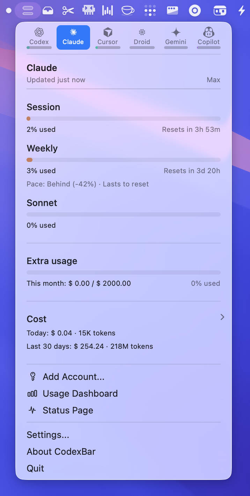

# CodexBar 🎚️ - May your tokens never run out.

Tiny macOS 15+ menu bar app that keeps your Codex and Claude Code limits visible (5‑hour/session + weekly windows) and when each window resets. One status item per provider; enable either or both from Settings. No Dock icon, minimal UI, dynamic bar icons in the menu bar.

## Install
- Homebrew (UI app; Sparkle disabled): `brew install --cask steipete/tap/codexbar` (update via `brew upgrade --cask steipete/tap/codexbar`)
- Or download the ready-to-run zip from GitHub Releases: <https://github.com/steipete/CodexBar/releases>

Login story
- **Codex** — Prefers the local codex app-server RPC for 5h/weekly limits + credits. Falls back to a PTY scrape of `codex /status` (auth/email/plan from the RPC or `~/.codex/auth.json`). All parsing stays on-device; no browser required.
- **Claude Code** — Reads session + weekly + Sonnet-only weekly usage from the Claude CLI by running `/usage` + `/status` in a local PTY (no tmux). Shows email/org/login method directly from the CLI output. No browser or network calls beyond the CLI itself.
- **Provider detection** — On first launch we detect installed CLIs and enable Codex by default (Claude turns on when the `claude` binary is present). You can toggle either provider in Settings → General or rerun detection after installing a CLI.
- **Privacy note** — Wondering if CodexBar scans your disk? It doesn’t; see the discussion and audit notes in [issue #12](https://github.com/steipete/CodexBar/issues/12).

Icon bar mapping (grayscale)
- Top bar: 5‑hour window when available; if weekly is exhausted, the top becomes a thick credits bar (scaled to a 1k cap) to show paid credits left.
- Bottom bar: weekly window (a thin line). If weekly is zero you’ll see it empty under the credits bar; when weekly has budget it stays filled proportionally.
- Errors/unknowns dim the icon; no text is drawn in the icon to stay legible. Codex icons keep the eyelid blink; when Claude is enabled the template switches to the Claude notch/leg variant while keeping the same bar mapping.



## Features
- Dual providers: Codex status item (5h/weekly + credits) and Claude Code status item (session/weekly + Sonnet-only weekly limit) can be shown together; Codex defaults on, Claude turns on when the CLI is present. Both sections show last-updated time and surface errors inline.
- Codex path: prefers the codex app-server RPC (run with `-s read-only -a untrusted`) for rate limits and credits; falls back to a PTY scrape of `codex /status`, keeping cached credits when RPC is unavailable.
- Claude path: runs `claude /usage` and `/status` in a local PTY (no tmux) to parse session/week/Sonnet percentages, reset strings, and account email/org/login method; debug view can copy the latest raw scrape.
- Account line keeps data siloed: Codex plan/email come from RPC/auth.json, Claude plan/email come only from the Claude CLI output; we never mix provider identity fields.
- Auto-update via Sparkle (Check for Updates… menu item, auto-check enabled). Feed defaults to the GitHub Releases appcast (replace SUPublicEDKey with your Ed25519 public key).

## Build & run
```bash
swift build -c release          # or debug for development
./Scripts/package_app.sh        # builds CodexBar.app in-place
open CodexBar.app
```

Requirements:
- macOS 15+.
- Codex: Codex CLI ≥ 0.55.0 installed and logged in (`codex --version`) to show the Codex row + credits. If your account hasn’t reported usage yet, the menu will show “No usage yet.”
- Claude: Claude Code CLI installed (`claude --version`) and logged in via `claude login` to show the Claude row. Run at least one `/usage` so session/week numbers exist.

## Refresh cadence
Menu → “Refresh every …” presets: Manual, 1 min, 2 min, 5 min (default), 15 min. Manual still allows “Refresh now.”

## Notarization & signing
```bash
export APP_STORE_CONNECT_API_KEY_P8="***REMOVED***"
export APP_STORE_CONNECT_KEY_ID="ABC123XYZ"
export APP_STORE_CONNECT_ISSUER_ID="00000000-0000-0000-0000-000000000000"
./Scripts/sign-and-notarize.sh
```
Outputs `CodexBar-<version>.zip` ready to ship. Adjust `APP_IDENTITY` in the script if needed.

## How account info is read
Account details stay local and per-provider:
- Codex: email/plan come from the codex RPC response; falls back to decoding `~/.codex/auth.json` (JWT only) if the RPC is unavailable.
- Claude: email/org/login method are pulled from the Claude CLI `/status` output.
- We never mix provider data (no showing Claude org in Codex mode, etc.). Nothing is sent anywhere.

## Limitations / edge cases
- Codex: if Codex hasn’t returned rate limits yet, you’ll see “No usage yet.” Run one Codex prompt and refresh.
- Codex: if the event schema changes, percentages may fail to parse; the menu will show the error string while keeping cached credits.
- Claude: if the CLI is missing or not logged in you’ll see the CLI error (e.g., “Claude CLI is not installed” or “claude login”).
- Claude: reset strings sometimes omit time zones; we surface the raw text when parsing fails.
- Only arm64 build is scripted; add `--arch x86_64` if you want a universal binary.

## Release checklist
See `docs/RELEASING.md` for the full CodexBar release flow, including signing, notarization, appcast generation, and asset validation.

## Changelog
See [CHANGELOG.md](CHANGELOG.md).

## Related
- ✂️ [Trimmy](https://github.com/steipete/Trimmy) — “Paste once, run once.” Flatten multi-line shell snippets so they paste and run.
- 🧳 [MCPorter](https://mcporter.dev) — TypeScript toolkit + CLI for Model Context Protocol servers.
- Cross-promote: Download CodexBar at [codexbar.app](https://codexbar.app) and Trimmy at [trimmy.app](https://trimmy.app).

License: MIT • Peter Steinberger ([steipete](https://twitter.com/steipete))
